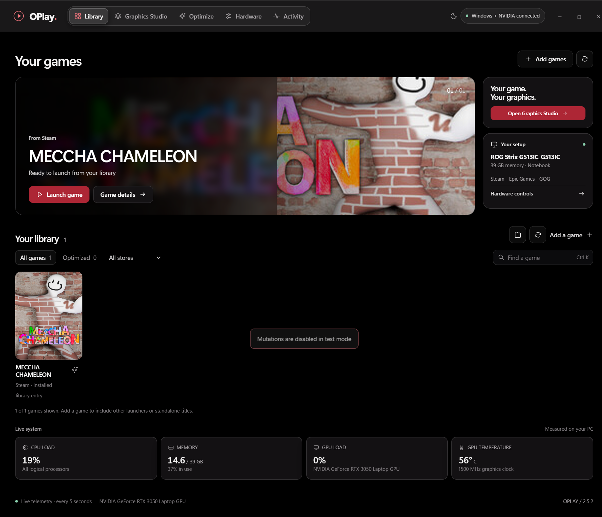

# OPlay 2.5.2 for Windows

OPlay is a local Windows game library with graphics runtime management, live telemetry and reversible system profiles. Download `OPlay-2.5.2-Windows.exe` from the [official releases](https://github.com/Anshuu0046/OPlay/releases). Run the portable executable; it extracts before opening. Windows x64; verified on Windows 11. The executable is unsigned, so Windows SmartScreen may ask for confirmation. Check the release SHA-256 before running it.

The [public download site](https://oplay-windows-library.anshumantripathy0056.chatgpt.site/) provides the latest verified release link. The source and documentation are in this repository. OPlay is independent from DLSS Swapper, DLSS 5 Manager and OptiScaler.



## Interface

The interface uses one horizontal frosted glass navigation bar, restrained red accents, native glass, widescreen game artwork, a cover grid and dark/light themes. Steam hero artwork is read separately from portrait covers. Windows 11 22H2+ uses native DWM Acrylic; older Windows has a fallback. System transparency preferences are preserved. The initial window fits the monitor work area. Keyboard navigation, drag selection, reduced motion, visible focus states and 1040-pixel layouts are tested. The game picker is a keyboard-accessible glass menu; top-edge window control clicks are covered by the UI test.

## Graphics Studio

- **Game profiles:** inspect an actual installation for DLSS, FSR and XeSS runtime DLLs, their versions and signatures.
- **Game details:** choose a library game and directly install the latest community MFG/neural package or an OptiScaler FSR frame-generation route. The same panel offers launch, per-game Windows optimization and a link to Graphics Studio. MFG and neural buttons use the same upstream package; the FSR 3 / 4 route uses OptiScaler. Installing files is not proof that a game activates them.
- **Installed state and transfers:** game details and Graphics Studio verify OPlay-managed installed files against the saved SHA-256 journal. They show verified, changed, missing or restore-pending states. The download tray shows the current package, transferred bytes and percentage when the server supplies a total, then verification, completion or an error. Without a total, progress remains indeterminate rather than estimating a percentage. Existing manually installed files are listed by **Inspect game**; they are not claimed as OPlay installs.
- **Launch checks and crash recovery:** after installing a graphics package, OPlay starts the game through its saved launcher route, waits for a game process, watches startup for 25 seconds and reads matching Windows Application Error events. It then watches for later crashes for up to 90 minutes while OPlay stays open. It records the timestamp, faulting executable/module, exception code, nearby NVIDIA driver events and graphics log hints, then gives a likely cause. The launch report also distinguishes an initialized MFG module from a neural runtime that NVIDIA's loader refused to load; file installation alone is not shown as feature activation. When an early crash is recorded, it checks the entire OPlay transaction before restoring its files and runs a second startup check. If a later crash occurs while an OPlay profile remains installed, it safely restores that profile and asks you to run **Test launch** when ready. External changes block automatic restoration rather than causing a partial rollback. A process remaining open for 25 seconds does not prove menus, gameplay or frame generation work.
- **Conflicting proxy recovery:** when installing OptiScaler or DLSS Unlocked, OPlay temporarily stages existing `dinput8.dll`, `version.dll` and `winmm.dll` files beside the game executable. Their original bytes are backed up in the same transaction and restored on rollback. This avoids running several graphics injection entry points together. OPlay does not alter proxies outside the selected game executable directory.
- **Community downloads:** Runtime library has separate download and install actions for the DLSS Unlocked bundle and OptiScaler FSR frame-generation route. Cached status survives an app restart. The current DLSS Unlocked archive includes FSR upscaling and frame-generation DLLs, but its bundled versions can lag AMD's current SDK.
- **Runtime library:** OPlay checks the upstream DLSS Swapper DLL catalog and community release feeds on startup and once per day while open. Manual refresh is available. Only curated, non-development entries marked signed are listed. Downloaded DLLs must match the catalog hash, contain an x64 PE image and have a valid Windows NVIDIA/AMD/Intel publisher signature. A SHA-256 is recorded locally. You can swap an existing component or directly install a downloaded DLL beside a selected game executable even when it was absent.
- **OptiScaler profiles:** download pinned upstream OptiScaler 0.9.4, check its SHA-256, and install a DX12 x64 profile beside the selected game executable. Choose automatic/DLSS/FSR/XeSS upscaling and off/FSR/XeSS frame generation. The profile selects a native DLSSG input when found, otherwise the existing upscaler input. Compatibility and overlay configuration still need checking in the game. Runtime binaries and license files come from upstream; OPlay does not run the upstream batch installer.
- **Experimental DLSS Unlocked route:** OPlay checks [ShyVortex's DLSS Unlocked releases](https://github.com/ShyVortex/dlss-unlocked/releases) daily and offers the latest standalone package from within Graphics Studio. On request it downloads the upstream archive, checks GitHub's published SHA-256, extracts an allowlisted set of proxy, MFG, OptiScaler and neural-rendering files, checks DLL architecture, pairs its Ampere MFG loader with the latest signed DLSS-G 310.x runtime from the verified DLL catalog, and enables the package's neural-rendering profile before installation. These files are installed in one reversible transaction beside the selected game executable. No package binaries are bundled with OPlay. The `NR-v0.9.81` package and paired runtime were verified in an isolated fixture and a real Ghost of Tsushima install. Its log confirmed that the MFG loader initialized; in-game generated frames and neural output have not been independently measured.
- **FSR release feed:** OPlay checks AMD's official FidelityFX SDK release metadata daily. As of SDK 2.4.0 its notes list FSR Upscaling 4.1.2; that release has no standalone DLL asset. The runtime DLL catalog remains the app's source for downloadable signed game DLLs.
- **Restore points:** original files are backed up before writes. Staged files are checked and renamed into place. A failure rolls back earlier writes. Restore verifies hashes and preserves later changes made by a game updater or another mod. Mod-edited INI settings are saved under `components/recovery` before a graphics profile is restored. Other changed files still block rollback. Unfinished profiles block OPlay's game launch until restored. Original DLLs remain in the component backup folder even after a successful restore.

Close the game before installing; OPlay checks for running game processes. OPlay no longer blocks installation based on GPU model, an absent upscaler DLL or anti-cheat indicators. It does not bypass or disable anti-cheat; modifying protected or online titles can have account consequences. Existing proxy files are backed up before replacement. Protected WindowsApps permissions are never changed. Files outside the selected package or named runtime remain unchanged. OptiScaler has its own generated INI, backed up if one existed.

### Technology support is explicit

| Feature | OPlay behavior |
|---|---|
| DLSS / FSR / XeSS runtime files | Swap existing DLLs or directly place a downloaded verified DLL beside the game executable. |
| Community frame generation / MFG | Install OptiScaler profiles or the current DLSS Unlocked upstream package, including its MFG modules. Verify the selected route in-game. |
| DLSS neural rendering | Install the upstream community forwarder/model package; OPlay does not claim it activates in every game or GPU. |
| FSR 4.1.2 | Track AMD SDK 2.4.0; downloadable DLLs appear when a trusted upstream catalog supplies one. |
| ReShade / Live Flow screen processing | Not included in this release. |

No FPS gain, artifact-free output, or compatibility in every game is promised. DLL swaps can prevent a game from launching; restore its originals if needed.

## Source research

Reviewed the available upstream source directly; no executable decompilation was needed. OPlay's component manager is an independent implementation; upstream app source/assets are not bundled.

- [DLSS Swapper](https://github.com/beeradmoore/dlss-swapper), commit `53b1ecc9d9ae59a23bb3e6194a55ba6243426d9c`: inspected game/runtime discovery, catalog records, downloads and restoration. Its public catalog supplies release metadata. Its code is GPL-3.0; no app code was copied into OPlay.
- [DLSS 5 Manager](https://github.com/NODIX-TECH/DLSS-5-MANAGER), commit `4610db5cf8fffe8d571d9284870cfd07a22bf140`: reviewed game analysis, installation tracking, component routes and separate screen-processing assets. Its original-code copyright notice does not grant a blanket reuse license. Its app code/assets/private cloud payloads were not copied.
- [OptiScaler installation](https://github.com/optiscaler/OptiScaler/wiki/Installation) and [frame-generation options](https://github.com/optiscaler/OptiScaler/wiki/Frame-Generation-Options): used documented profile keys and game requirements. In-game restart/overlay verification remains necessary.
- [DLSS Unlocked](https://github.com/ShyVortex/dlss-unlocked), commit `b90a5ef0a2c9fae331f9925f232dba84fbb1839f`: inspected its documented standalone layout and latest release. OPlay downloads but does not copy its source or bundle its large package. Its own instructions call for game DLSS upscaling and FG input, and recommend single-player use.
- [AMD FidelityFX SDK 2.4.0](https://github.com/GPUOpen-LibrariesAndSDKs/FidelityFX-SDK/releases/tag/v2.4.0): official FSR 4.1.2 release notes; no standalone game DLL was published as a release asset at the time checked.
- [NVIDIA DLSS technology matrix](https://www.nvidia.com/en-us/geforce/technologies/dlss/) and [DLSS 5 FAQ](https://www.nvidia.com/en-us/geforce/forums/nvidia-app/129/583738/dlss-5-faq-932026/): hardware claims are separate from experimental community routes. The examined RTX 3050 supports DLSS SR; it is not native DLSS 5/MFG hardware.

OptiScaler package pinned for this build: `Optiscaler_0.9.4-final.20260718._MM.7z`, SHA-256 `575cb4df866116093df75af607e37fd70e10f5163e0f23fd5c804142e80ef0ad`, obtained from its official GitHub release. No vendor runtime binaries are included in the OPlay executable or source archive.

## Library and existing controls

Steam, Epic and GOG manifests are read locally. Registry-backed Ubisoft Connect, Battle.net and EA game folders are also discovered where available. Other games can be imported through Add game / Scan folder. Xbox protected package discovery/modification is not implemented; accessible game executables can be added manually. Offline saved entries remain visible, with availability checked before launch.

Existing Windows optimization, CPU power profiles, process priority guard, manual NVIDIA GPU/VRAM offsets, V/F curve editing, telemetry and automatic error logging remain available. Global optimization changes Windows Game Mode, background capture and per-game GPU preferences with backups and read-back checks. In-game graphics files are preserved. Keep OPlay open/minimized for the priority guard.

GPU/VRAM and V/F curve sessions use the elevated small helper. Original settings are journaled and restored on exit, disconnect, lost heartbeat or thermal threshold. Curve writes currently use private NVAPI Ampere layouts; future drivers can reject them. A flat V/F curve is not a hard voltage cap. CPU multiplier and system-RAM timing/frequency writes remain unavailable on the examined ASUS G513IC / Ryzen 4800H firmware. Windows power profiles are not CPU frequency overclocking. No kernel driver, firmware patch, security bypass or startup service is installed.

## Data and logs

The existing `%APPDATA%/Aether` profile is deliberately retained through the rename so existing games, backups and recovery records remain accessible. Component cache and write-ahead records are under its `components` subfolder. GPU helper recovery remains under `%LOCALAPPDATA%/Aether`. Do not discard recovery records while changes remain.

Activity > Open error logs opens local `logs/errors.jsonl`. App operations, helper failures, renderer errors and crashes are recorded automatically. Logs rotate at 1 MiB with three backups and suppress identical repeats for one minute. Common credential patterns are redacted. Logs can contain local paths; inspect before sharing. No logs are uploaded. Unwritable/full storage cannot prevent recovery but can prevent logging.

## Verification and development

```
npm ci
npm test
node test/ui.cjs
node test/components-live.cjs
powershell -NoProfile -File test/curve-plan.ps1
powershell -NoProfile -File test/nvidia-sensor.ps1
node test/windows-live.cjs
npm run dist
node test/ui.cjs ../../outputs/build/win-unpacked/OPlay.exe
node test/portable.cjs ../../outputs/build/OPlay-2.5.2-Windows.exe
```

`components-live` uses a generated fixture with real signed upstream runtimes; it never launches the fixture or modifies a user game. It verifies download/signature checks, DLL swap/restore, upstream OptiScaler extraction/profile installation and exact restoration of the initial folder. `unlocked-live` verifies the full checksum-matched community package in a generated fixture, then restores the folder exactly. Run `node test/unlocked-live.cjs <optional path to verified standalone ZIP>` to repeat it; without a local archive it downloads the current package. Unit tests cover tampered catalogs, traversal/links, direct installs, preservation of external changes, restart recovery and rollback after an injected locked-file failure. UI tests use isolated profiles, disable OS/game mutations, and check library interactions, both themes, Graphics Studio, native Acrylic, keyboard/drag/reduced-motion behavior, layouts, sandboxing and automatic error logs.

The existing hardware-test evidence distinguishes driver read-back/watchdog results from game stability/FPS benchmarks. Hardware-write tests require UAC and must not be confused with the isolated UI suite. Ghost of Tsushima was launched with the community MFG package; its startup and loader initialization were observed, but no FPS or generated-frame benchmark was captured.

The 2.1 interface revision was designed directly from the supplied feedback without UI/UX Pro Max. Runtime npm dependencies have no advisories in the checked tree; development packaging dependencies have moderate transitive advisories and are not shipped as runtime dependencies.

The final log review also reproduced an older NVIDIA UI temperature-format failure. The shared numeric parser now treats unavailable/non-finite labels as missing data while preserving the hot-CPU calibration gate; the dedicated sensor test passes without starting calibration.
